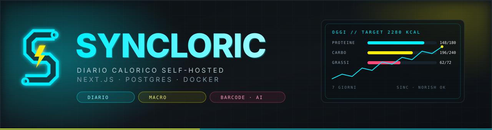
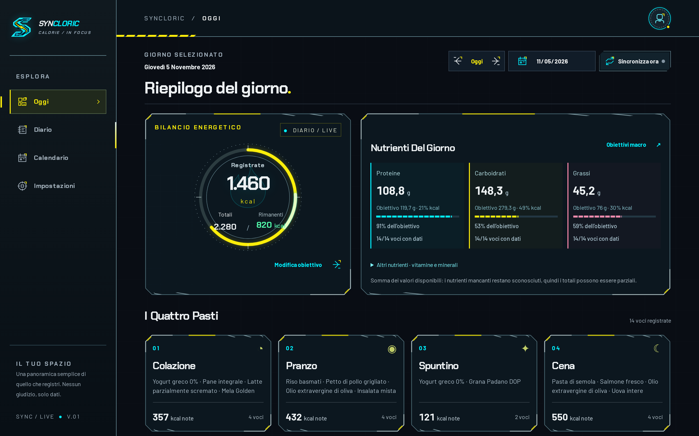
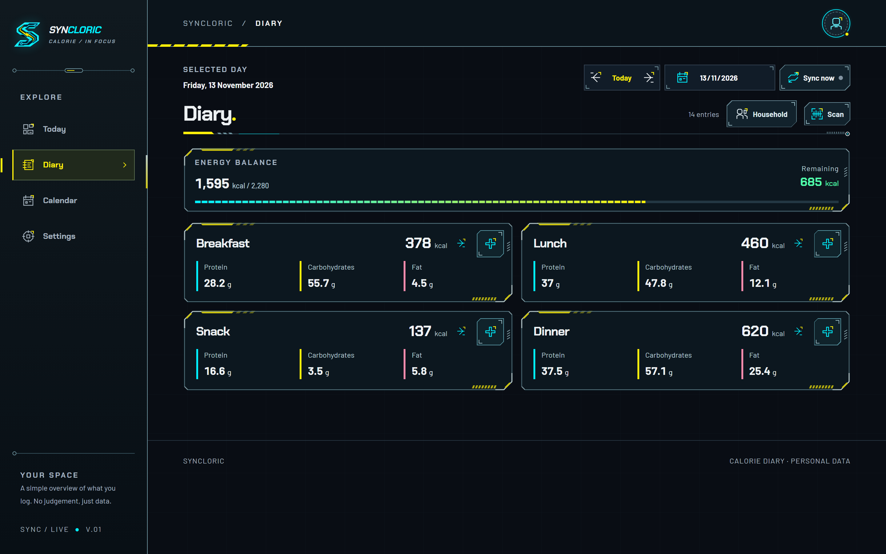
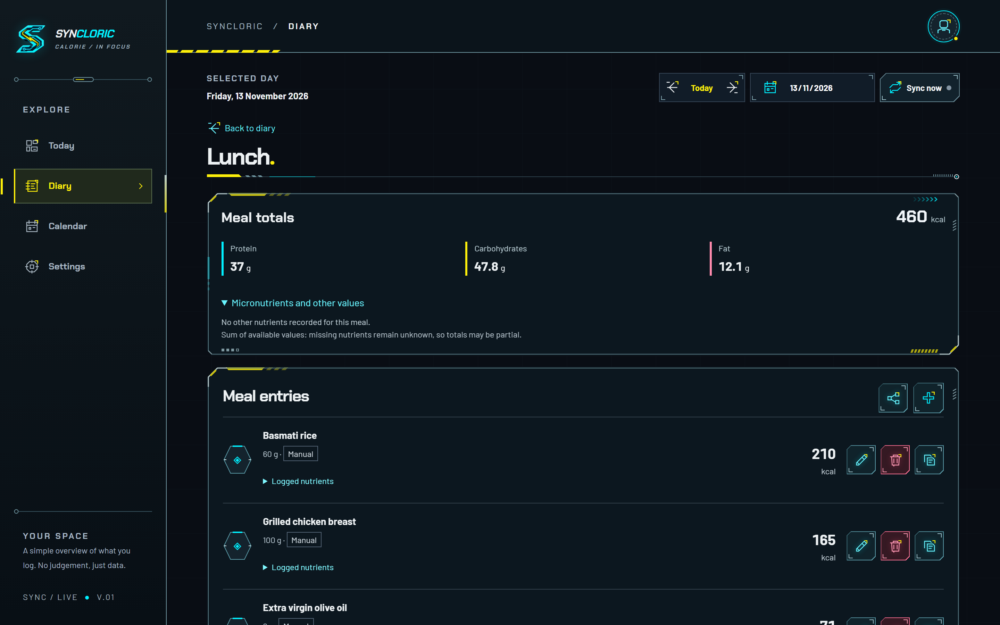
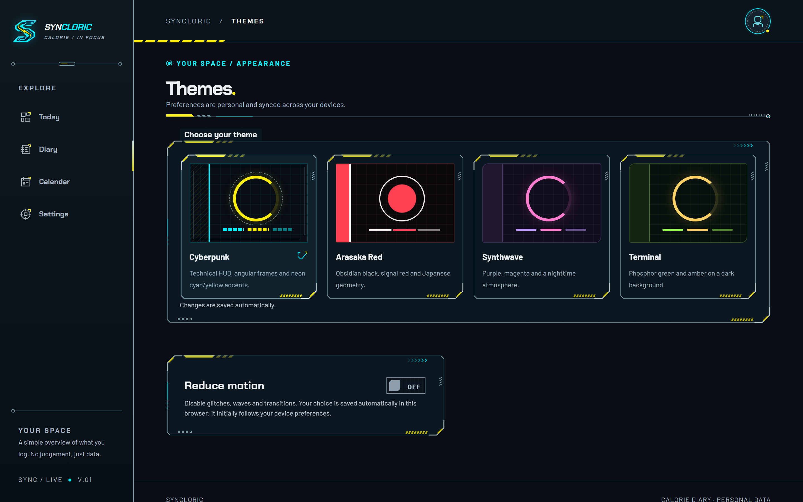
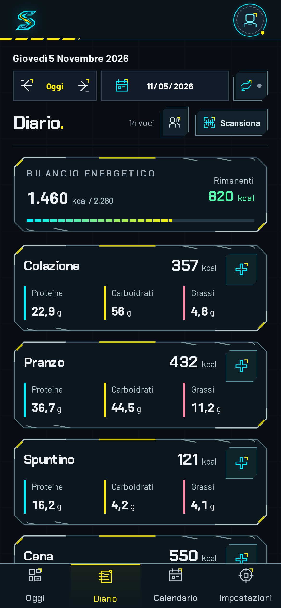

<div align="center">



<br>

[](https://github.com/Coagenti/Syncloric/actions/workflows/ci.yml)
[](LICENSE)


**Diario de calorías autoalojado, con una interfaz cyberpunk y una sincronización de solo lectura hacia Norish.**

Un contenedor, una base de datos, tus datos en tu propia máquina. Sin cuentas en servicios de terceros.

[English](README.md) · [Italiano](README.it.md) · **Español**

</div>

---

## Qué es

Syncloric cuenta las calorías y los macros de lo que comes, día a día: cuatro comidas,
porciones, recetas, códigos de barras, lectura de la etiqueta con IA (opt-in) e importación
automática de las comidas que registras en una instancia de
[Norish](https://github.com/norish-recipes/norish). Se ejecuta por completo en tu propio servidor,
en un único stack de Docker Compose.

Nació como un proyecto real, usado cada día: el diario no es una demo y las vistas solo leen tus
propios datos de tu propia base de datos.

## Capturas

> Capturas de una instancia local con **datos ficticios** (ningún dato real de personas).

<div align="center">
  
  
  <br>
  
  
  <br>
  
</div>

## Funcionalidades

**Diario y nutrición**

- Diario diario en cuatro comidas (desayuno, comida, merienda, cena) con kcal, proteínas,
  carbohidratos, grasas y los micronutrientes disponibles por cada entrada y por comida.
- Entrada manual, búsqueda de alimentos con porciones y medidas propias, recetas con porciones.
- Calendario mensual para recorrer el historial; la fecha «hoy» es la local del navegador.
- Objetivo calórico **calculado** (sexo, altura, peso, edad, actividad, objetivo) o **manual**,
  guardado por usuario. Números informativos, no prescripciones nutricionales.

**Obtención de datos**

- **Código de barras**: se puede escribir a mano, cámara nativa donde el navegador la soporta,
  búsqueda local-first con fallback a Open Food Facts, confirmación del producto y de los gramos
  antes de escribir nada.
- **Etiqueta con IA** (opt-in, decisión del administrador): foto de la etiqueta → valores
  nutricionales en una vista previa → confirmación explícita. Proveedor OpenAI, Anthropic u Ollama
  local; Syncloric nunca guarda ni registra las fotos.
- **Sincronización Norish** en modo **solo lectura**: importa las comidas del calendario y sus
  kcal, con reconciliación semanal/mensual; las entradas importadas siguen siendo propiedad de la
  sincronización.

**Compartir y datos**

- Hogares: invitaciones, compartición de comidas y copia de una comida de un miembro a otro.
- Exportación completa en JSON/CSV y tokens de exportación de solo lectura.
- Cada usuario gestiona su propia clave de Norish desde la interfaz; las claves se cifran en
  reposo (AES-256-GCM) y nunca se devuelven a las páginas.

**Interfaz**

- Cuatro temas (Cyberpunk, Arasaka Red, Synthwave, Terminal), italiano e inglés, preferencias
  sincronizadas por usuario.
- Opción **Reducir animaciones** para quien prefiere menos movimiento.
- Mobile-first e instalable como PWA sobre HTTPS.

**Administración**

- El primer usuario de la instancia es el administrador; panel de usuarios con roles, bloqueos y
  auditoría de los cambios. Suplantación deshabilitada.
- Claves de IA y proveedor, umbral del código de barras, URL de Norish: configuración global desde
  `/settings`, guardada en la base de datos (los secretos cifrados).

## Inicio rápido (Docker)

```bash
git clone https://github.com/Coagenti/Syncloric.git
cd Syncloric
cp docker/.env.example docker/.env
# rellena en docker/.env los tres secretos obligatorios:
#   POSTGRES_PASSWORD   (URL-safe: usa hexadecimal)
#   BETTER_AUTH_SECRET  (al menos 32 caracteres)
#   ENCRYPTION_KEY      (64 dígitos hexadecimales)
# y ajusta BETTER_AUTH_URL al origen público, p. ej. https://diario.example.com
chmod 600 docker/.env
docker compose -f docker/docker-compose.yml --env-file docker/.env -p syncloric up -d --wait
```

La app responde en `http://localhost:3000` (`APP_PORT` para cambiar el puerto). En el primer
acceso crea la cuenta desde la página de registro: **el primer usuario de la instancia se
convierte en admin**.

Guarda `ENCRYPTION_KEY` junto a las copias de seguridad de la base de datos: sin esa clave las
credenciales cifradas (claves de Norish/IA) ya no se pueden leer. No hagas commit de `docker/.env`
y no imprimas `docker compose config` en logs compartidos: contiene los secretos resueltos.

Health checks: `GET /api/health` (app) y `GET /api/v1/health` (app + base de datos).

## Desarrollo local

Requisitos: Node.js 22 (ver `.nvmrc`), pnpm 10, PostgreSQL 17 (o Docker solo para la base de
datos).

```bash
corepack enable
pnpm install
cp .env.example .env      # valores de desarrollo, ver los comentarios del archivo
pnpm db:migrate           # aplica las migraciones drizzle a DATABASE_URL
pnpm dev                  # http://localhost:3000
```

El bootstrap (`src/instrumentation.ts`) valida el entorno: sin `DATABASE_URL`,
`BETTER_AUTH_SECRET` ni `ENCRYPTION_KEY` la app no arranca. `NORISH_BASE_URL` es opcional y sin
valor por defecto: si falta, el planificador se ejecuta pero omite la sincronización.

## Pruebas

```bash
pnpm test:unit              # vitest: config, cliente Norish (fetch simulado), crypto
pnpm test:integration       # vitest + PGlite (Postgres WASM) sobre las mismas migraciones
pnpm test                   # ambos
pnpm build                  # requisito previo de las pruebas de navegador
pnpm test:settings-browser  # Chromium real + componentes/APIs de producción sobre PGlite
```

Las pruebas de integración no necesitan Docker: PGlite es un Postgres WASM en proceso con las
migraciones drizzle reales. Los harness de Chromium comprueban componentes y APIs reales (ajustes,
feed, código de barras, auth con sesiones reales de Better Auth), con los upstream HTTP simulados:
ninguna prueba contacta servicios externos y no se hace ninguna llamada real de IA.

## Cómo funciona el diario

`/dashboard`, `/diary` y `/calendar` leen `GET /api/v1/diary?month=YYYY-MM`, que requiere una
sesión válida y filtra por el usuario actual; la respuesta es `private, no-store` y no contiene
claves ni mensajes crudos del upstream. Las escrituras pasan por `POST /api/v1/diary` y
`PATCH`/`DELETE /api/v1/diary/:id` (contratos en [DIARY-WRITES](docs/DIARY-WRITES.md) y
[DIARY-MUTATE](docs/DIARY-MUTATE.md)); las entradas llegadas de la sincronización (`norish_sync`)
responden `403` a cualquier modificación manual. La vista de entrada se describe en
[FOOD-ENTRY](docs/FOOD-ENTRY.md).

Las sesiones viven en cookies HTTP-only (no en `localStorage`) y los roles se leen de la base de
datos, sin caché de autorización. Si el bootstrap del primer admin falla por un error transitorio,
el siguiente inicio de sesión lo reintenta.

## Norish: integración y reconciliación

La conexión con Norish usa **la clave personal de cada usuario**, guardada desde la interfaz y
cifrada con AES-256-GCM. `NORISH_API_KEY` ya no se usa. El cliente solo expone `GET /api/v1/**`
hacia el upstream: Syncloric nunca escribe en Norish.

El planificador resuelve la URL efectiva en cada tick (cada 30 minutos) con la precedencia
**Ajustes → variable de entorno → ninguna URL**: sin URL no registra ejecuciones y no contacta el
upstream. El contrato está fijado a Norish `v0.24.0-beta`: la sincronización semanal reconcilia
lunes–domingo, el backfill `month` el mes entero; las entradas que desaparecen del upstream se
marcan como eliminadas (nunca se borran físicamente) y se restauran si vuelven. Con payload vacío
el valor por defecto es **cero marcados**: para autorizarlos hace falta `NORISH_UPSTREAM_TZ` con
la zona horaria realmente verificada del servidor Norish (ningún valor implícito). Solo un fetch
completo habilita los marcados; un error 401/403 produce `reason=auth` sin tocar las credenciales.

Detalles: [ARCHITECTURE § 5](docs/ARCHITECTURE.md), [configuración en tiempo de ejecución](docs/configuration.md),
[contrato de Ajustes](docs/NORISH-SETTINGS.md). Las fixtures en `docs/norish-api/` son capturas
del contrato observado, no un endpoint que configurar.

## Etiqueta con IA

Un administrador habilita la función y elige el proveedor en `/settings`; sin proveedor, o con
`ai.enabled=false`, el escaneo sigue deshabilitado y el formulario manual funciona igual. Las
claves de OpenAI/Anthropic se introducen desde la interfaz, se cifran en la base de datos y tienen
precedencia sobre las eventuales claves de entorno heredadas; la interfaz solo muestra el estado y
un campo vacío para sustituirlas. Ollama no requiere claves y usa `OLLAMA_BASE_URL`.
`SYNCLORIC_AI_MODEL` permite sobrescribir el modelo de visión.

La foto no se envía hasta que pulsas el botón, la interfaz declara el destinatario y la lectura
hay que verificarla antes de confirmar: es una ayuda, no un consejo dietético. Privacidad, APIs y
límites: [AI-LABEL](docs/AI-LABEL.md), [configuration](docs/configuration.md).

## Despliegue y entornos

La plantilla `.env.example` de la raíz es para desarrollo; para el despliegue usa
`docker/.env.example` (`NORISH_BASE_URL`, `NORISH_UPSTREAM_TZ`, `BETTER_AUTH_URL`). Detrás de un
proxy inverso, ajusta `BETTER_AUTH_URL` al origen público HTTPS que el navegador ve realmente: la
autenticación y las escrituras de la API usan el mismo valor.

Para una segunda instancia basta con un `.env` separado y un nombre de proyecto distinto: redes,
volúmenes y secretos quedan aislados, y la imagen es la misma.

```bash
APP_PORT=3001 docker compose -f docker/docker-compose.yml --env-file docker/.env.second -p syncloric-b up -d --wait
```

Procedimiento completo (build, cutover, migraciones, rollback) en **[docs/DEPLOY.md](docs/DEPLOY.md)**.
El camino recomendado es construir la imagen **una vez** en CI, publicarla por digest y dejar que
los servidores solo hagan `pull`: sin transferencias de archivos, sin secretos en las capas.

## Estado del proyecto

La aplicación está completa y se usa a diario (v0.2.1). Abierto y en curso:

- separación estricta de los secretos entre entornos de desarrollo, prueba y producción;
- cobertura de pruebas en algunas vistas (ver `docs/`), accesibilidad y rendimiento en
  dispositivos lentos.

El código llega mediante ramas y pull requests, sin merges directos a `main`; cada PR pasa por
`lint → typecheck → unit → integration → build` más la regresión de navegador. Ver
[CONTRIBUTING.md](CONTRIBUTING.md).

## Documentación

_La documentación del proyecto está por ahora escrita en italiano._

| Documento | Contenido |
|---|---|
| [ARCHITECTURE](docs/ARCHITECTURE.md) | stack, estructura, modelo de datos, sincronización, despliegue |
| [DEPLOY](docs/DEPLOY.md) | build, cutover, migraciones, rollback |
| [DIARY-UI](docs/DIARY-UI.md) · [FOOD-ENTRY](docs/FOOD-ENTRY.md) | diario, entrada, catálogos |
| [BARCODE](docs/BARCODE.md) · [AI-LABEL](docs/AI-LABEL.md) | escaneo de códigos, lectura de etiquetas |
| [HOUSEHOLDS-MEAL-SHARING](docs/HOUSEHOLDS-MEAL-SHARING.md) | hogares y compartición de comidas |
| [ADMINISTRATION](docs/ADMINISTRATION.md) | roles, auditoría, claves, límites del panel |
| [MOBILE-NUTRITION-EXPORT](docs/MOBILE-NUTRITION-EXPORT.md) | móvil, nutrientes, exportación |

## Licencia

Copyright (C) 2026 Coagenti.

Syncloric se distribuye bajo la **GNU Affero General Public License v3.0 o posterior**
(`AGPL-3.0-or-later`). El texto completo está en [`LICENSE`](LICENSE).

En la práctica: puedes usarlo, modificarlo y autoalojarlo libremente; si lo ofreces como servicio
accesible en red debes poner a disposición el código fuente de tus modificaciones (AGPL § 13).
Para usos que no pueden cumplir la AGPL — por ejemplo una oferta comercial con modificaciones no
publicadas — existe una **licencia comercial**: contacta con los mantenedores a través del perfil
de la organización.

El nombre «Syncloric», el logo y la identidad visual **no** están cubiertos por la licencia del
código.

Cómo contribuir (incluidas las condiciones sobre las contribuciones):
[`CONTRIBUTING.md`](CONTRIBUTING.md). Cómo informar de una vulnerabilidad:
[`SECURITY.md`](SECURITY.md).
