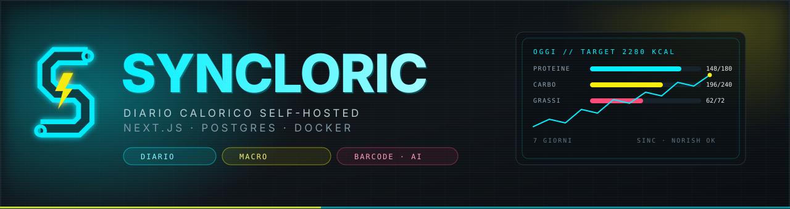
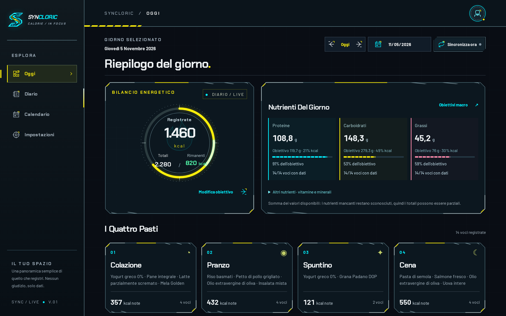
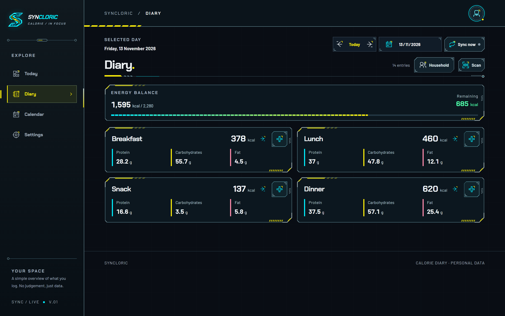
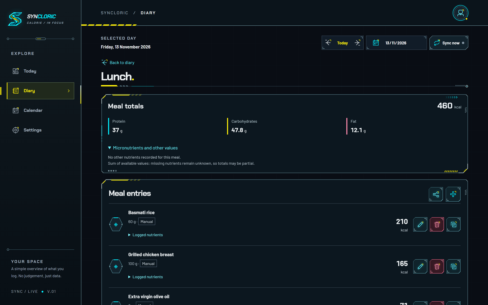
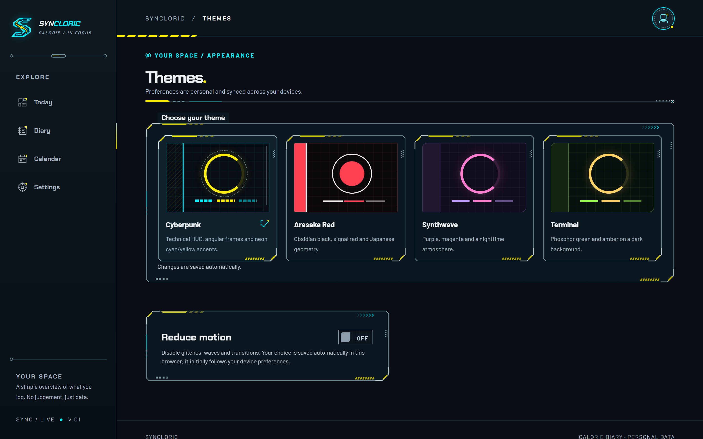
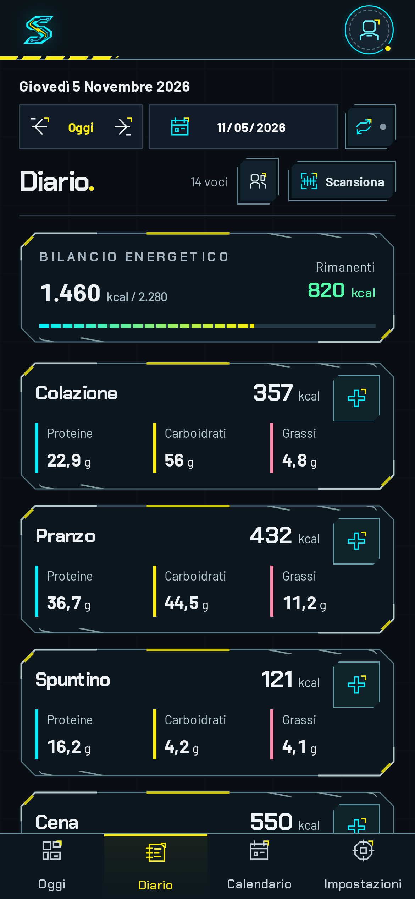

<div align="center">



<br>

[](https://github.com/Coagenti/Syncloric/actions/workflows/ci.yml)
[](LICENSE)


**Diario calorico self-hosted, con un'interfaccia cyberpunk e un sync in sola lettura verso Norish.**

Un container, un database, i tuoi dati a casa tua. Nessun account su un servizio di terzi.

</div>

---

## Cos'è

Syncloric conta calorie e macro di quello che mangi, giorno per giorno: quattro pasti,
porzioni, ricette, barcode, lettura dell'etichetta con AI (opt-in) e import automatico dei
pasti che segni su un'istanza [Norish](https://github.com/norish-recipes/norish). Gira interamente
sul tuo server, in una singola istanza Docker Compose.

Nato come progetto reale e usato ogni giorno: il diario non è una demo, le viste leggono
solo dati tuoi dal tuo database.

## Screenshot

> Istantanee di un'istanza locale con **dati fittizi** (nessun dato reale di persone).

<div align="center">
  
  
  <br>
  
  
  <br>
  
</div>

## Funzionalità

**Diario e nutrizione**

- Diario giornaliero su quattro pasti (colazione, pranzo, spuntino, cena) con kcal, proteine,
  carboidrati, grassi e micronutrienti disponibili per singola voce e per pasto.
- Inserimento manuale, ricerca alimenti con porzioni e misure personali, ricette con porzioni.
- Calendario mensile per navigare lo storico; la data «oggi» è quella locale del browser.
- Obiettivo calorico **calcolato** (sesso, altezza, peso, età, attività, obiettivo) oppure
  **manuale**, salvato per utente. Numeri informativi, non prescrizioni nutrizionali.

**Acquisizione dati**

- **Barcode**: codice digitabile a mano, camera nativa dove il browser la supporta, ricerca
  locale-first con fallback su Open Food Facts, conferma prodotto e grammi prima della scrittura.
- **Etichetta con AI** (opt-in, scelta dell'admin): foto dell'etichetta → valori nutrizionali in
  preview → conferma esplicita. Provider OpenAI, Anthropic o Ollama locale; le foto non vengono
  salvate né loggate da Syncloric.
- **Sync Norish** in **sola lettura**: importa i pasti del calendario e le kcal associate, con
  riconciliazione settimanale/mensile; le voci importate restano di proprietà del sync.

**Condivisione e dati**

- Nuclei familiari: inviti, condivisione dei pasti e copia di un pasto da un membro all'altro.
- Export completo in JSON/CSV e token di export in sola lettura.
- Ogni utente gestisce la propria chiave Norish dalla UI; le chiavi sono cifrate a riposo
  (AES-256-GCM) e non vengono mai restituite alle pagine.

**Interfaccia**

- Quattro temi (Cyberpunk, Arasaka Red, Synthwave, Terminal), italiano e inglese, preferenze
  sincronizzate per utente.
- Opzione **Riduci animazioni** per chi preferisce meno movimento.
- Mobile-first e installabile come PWA con HTTPS.

**Amministrazione**

- Primo utente dell'istanza = amministratore; pannello utenti con ruoli, ban e audit delle
  modifiche. Impersonation disabilitata.
- Chiavi AI e provider, soglia barcode, URL Norish: configurazione globale da `/settings`,
  salvata in database (i segreti cifrati).

## Avvio rapido (Docker)

```bash
git clone https://github.com/Coagenti/Syncloric.git
cd Syncloric
cp docker/.env.example docker/.env
# compila in docker/.env i tre segreti obbligatori:
#   POSTGRES_PASSWORD   (URL-safe: usa esadecimale)
#   BETTER_AUTH_SECRET  (almeno 32 caratteri)
#   ENCRYPTION_KEY      (64 cifre esadecimali)
# e imposta BETTER_AUTH_URL all'origine pubblica, es. https://diario.example.com
chmod 600 docker/.env
docker compose -f docker/docker-compose.yml --env-file docker/.env -p syncloric up -d --wait
```

L'app risponde su `http://localhost:3000` (`APP_PORT` per cambiare porta). Al primo accesso
crea l'account dalla pagina di registrazione: **il primo utente dell'istanza diventa admin**.

Conserva `ENCRYPTION_KEY` insieme ai backup del database: senza quella chiave le credenziali
cifrate (chiavi Norish/AI) non sono più leggibili. Non committare `docker/.env` e non stampare
`docker compose config` in log condivisi: contiene i segreti risolti.

Health check: `GET /api/health` (app) e `GET /api/v1/health` (app + database).

## Sviluppo locale

Requisiti: Node.js 22 (vedi `.nvmrc`), pnpm 10, PostgreSQL 17 (o Docker per il solo database).

```bash
corepack enable
pnpm install
cp .env.example .env      # valori di sviluppo, vedi i commenti nel file
pnpm db:migrate           # applica le migrazioni drizzle al DATABASE_URL
pnpm dev                  # http://localhost:3000
```

Il bootstrap (`src/instrumentation.ts`) valida l'ambiente: senza `DATABASE_URL`,
`BETTER_AUTH_SECRET` o `ENCRYPTION_KEY` l'app non parte. `NORISH_BASE_URL` è opzionale e senza
default: se manca, lo scheduler gira ma salta il sync.

## Test

```bash
pnpm test:unit              # vitest: config, client Norish (fetch mockato), crypto
pnpm test:integration       # vitest + PGlite (Postgres WASM) sulle stesse migrazioni
pnpm test                   # entrambi
pnpm build                  # prerequisito dei test browser
pnpm test:settings-browser  # Chromium reale + componenti/API di produzione su PGlite
```

I test di integrazione non richiedono Docker: PGlite è un Postgres WASM in-process con le
migrazioni drizzle reali. Gli harness Chromium verificano componenti e API reali (settings,
feed, barcode, auth con sessioni Better Auth vere), con upstream HTTP mockati: nessun test
contatta servizi esterni, nessuna chiamata AI reale.

## Come funziona il diario

`/dashboard`, `/diary` e `/calendar` leggono `GET /api/v1/diary?month=YYYY-MM`, che richiede una
sessione valida e filtra per l'utente corrente; la risposta è `private, no-store` e non contiene
chiavi né messaggi upstream grezzi. Le scritture passano da `POST /api/v1/diary` e
`PATCH`/`DELETE /api/v1/diary/:id` (contratti in [DIARY-WRITES](docs/DIARY-WRITES.md) e
[DIARY-MUTATE](docs/DIARY-MUTATE.md)); le voci arrivate dal sync (`norish_sync`) rispondono `403`
a qualunque modifica manuale. La vista di inserimento è descritta in [FOOD-ENTRY](docs/FOOD-ENTRY.md).

Le sessioni vivono in cookie HTTP-only (non in `localStorage`) e i ruoli sono letti dal database,
senza cache di autorizzazione. Se il bootstrap del primo admin fallisce per un errore transitorio,
il login successivo lo ritenta.

## Norish: integrazione e riconciliazione

La connessione a Norish usa **la chiave personale di ogni utente**, salvata dalla UI e cifrata con
AES-256-GCM. `NORISH_API_KEY` non è più usata. Il client espone solo `GET /api/v1/**` verso
l'upstream: Syncloric non scrive mai su Norish.

Lo scheduler risolve l'URL effettivo a ogni tick (ogni 30 minuti) con precedenza
**Impostazioni → variabile d'ambiente → nessun URL**: senza URL non registra run e non contatta
l'upstream. Il contratto è pinnato a Norish `v0.24.0-beta`: il sync settimanale riconcilia
lunedì–domenica, il backfill `month` l'intero mese; le voci sparite dall'upstream vengono marcate
come rimosse (mai cancellate fisicamente) e ripristinate se ricompaiono. Con payload vuoto il
default è **zero marcature**: per autorizzarle serve `NORISH_UPSTREAM_TZ` con il fuso realmente
verificato del server Norish (nessun default implicito). Solo un fetch completo abilita le
marcature; un errore 401/403 produce `reason=auth` senza toccare le credenziali.

Dettagli: [ARCHITECTURE § 5](docs/ARCHITECTURE.md), [configurazione runtime](docs/configuration.md),
[contratto Impostazioni](docs/NORISH-SETTINGS.md). Le fixture in `docs/norish-api/` sono snapshot
del contratto osservato, non un endpoint da configurare.

## Etichetta con AI

Un admin abilita la funzione e sceglie il provider in `/settings`; senza provider, o con
`ai.enabled=false`, la scansione resta disabilitata e il form manuale funziona comunque. Le chiavi
OpenAI/Anthropic si inseriscono dalla UI, sono cifrate in database e hanno precedenza sulle
eventuali chiavi d'ambiente legacy; la GUI mostra solo lo stato e un campo vuoto per sostituirle.
Ollama non richiede chiavi e usa `OLLAMA_BASE_URL`. `SYNCLORIC_AI_MODEL` permette l'override del
modello vision.

La foto non viene inviata finché non premi il pulsante, la UI dichiara il destinatario, e la
lettura va verificata prima di confermare: è un aiuto, non un consiglio dietetico. Privacy, API e
limiti: [AI-LABEL](docs/AI-LABEL.md), [configuration](docs/configuration.md).

## Deploy e ambienti

Il template `.env.example` nella root è per lo sviluppo; per il deploy usa `docker/.env.example`
(`NORISH_BASE_URL`, `NORISH_UPSTREAM_TZ`, `BETTER_AUTH_URL`). Dietro un reverse proxy imposta
`BETTER_AUTH_URL` all'origine pubblica HTTPS che il browser vede davvero: auth e scritture API
usano lo stesso valore.

Per una seconda istanza basta un `.env` separato e un project name diverso: reti, volumi e
segreti restano isolati, e l'immagine è la stessa.

```bash
APP_PORT=3001 docker compose -f docker/docker-compose.yml --env-file docker/.env.second -p syncloric-b up -d --wait
```

Procedura completa (build, cutover, migrazioni, rollback) in **[docs/DEPLOY.md](docs/DEPLOY.md)**.
Il percorso consigliato è costruire l'immagine **una volta** in CI, pubblicarla per digest e far
eseguire ai server solo il `pull`: nessun trasferimento di archivi, nessun segreto nei layer.

## Stato del progetto

L'applicazione è completa e usata quotidianamente (v0.2.1). Aperto e in lavorazione:

- separazione rigida dei segreti fra ambienti di sviluppo, test e produzione;
- copertura test su alcune viste (vedi `docs/`), accessibilità e prestazioni su dispositivi lenti.

Il codice arriva tramite branch e pull request, senza merge diretti su `main`; ogni PR passa
`lint → typecheck → unit → integration → build` e la regressione browser. Vedi
[CONTRIBUTING.md](CONTRIBUTING.md).

## Documentazione

| Documento | Contenuto |
|---|---|
| [ARCHITECTURE](docs/ARCHITECTURE.md) | stack, struttura, modello dati, sync, deployment |
| [DEPLOY](docs/DEPLOY.md) | build, cutover, migrazioni, rollback |
| [DIARY-UI](docs/DIARY-UI.md) · [FOOD-ENTRY](docs/FOOD-ENTRY.md) | diario, inserimento, cataloghi |
| [BARCODE](docs/BARCODE.md) · [AI-LABEL](docs/AI-LABEL.md) | scansione barcode, lettura etichetta |
| [HOUSEHOLDS-MEAL-SHARING](docs/HOUSEHOLDS-MEAL-SHARING.md) | nuclei familiari e condivisione pasti |
| [ADMINISTRATION](docs/ADMINISTRATION.md) | ruoli, audit, chiavi, limiti del pannello |
| [MOBILE-NUTRITION-EXPORT](docs/MOBILE-NUTRITION-EXPORT.md) | mobile, nutrienti, export |

## Licenza

Copyright (C) 2026 Coagenti.

Syncloric è distribuito sotto **GNU Affero General Public License v3.0 o successiva**
(`AGPL-3.0-or-later`). Il testo completo è in [`LICENSE`](LICENSE).

In pratica: puoi usarlo, modificarlo e self-hostarlo liberamente; se lo offri come servizio
accessibile in rete devi rendere disponibile il sorgente delle modifiche (AGPL § 13). Per usi
che non possono rispettare l'AGPL — per esempio un'offerta commerciale con modifiche non
pubblicate — è disponibile una **licenza commerciale**: contatta i maintainer tramite il profilo
dell'organizzazione.

Il nome "Syncloric", il logo e l'identità visiva **non** sono coperti dalla licenza del codice.

Come contribuire (incluse le condizioni sui contributi): [`CONTRIBUTING.md`](CONTRIBUTING.md).
Come segnalare una vulnerabilità: [`SECURITY.md`](SECURITY.md).
